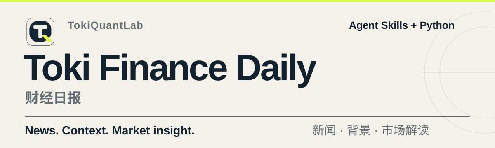
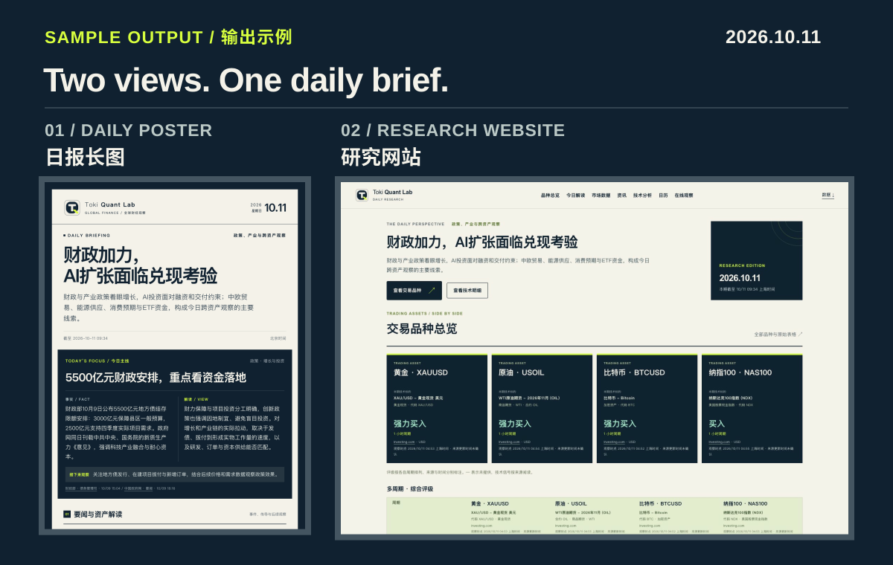

<picture>
  <source media="(max-width: 600px)" srcset="./assets/readme-hero-mobile.svg">
  
</picture>

**Toki Finance Daily** by [TokiQuantLab](https://github.com/TokiQuantLab) is an open-source AI financial daily briefing workflow. Agent Skills and Python turn financial news, economic calendars and market data into Chinese daily posters and a research website.

**Toki Finance Daily** 是 [TokiQuantLab](https://github.com/TokiQuantLab) 的开源 AI 财经日报项目。结合 Agent Skills 与 Python，整理财经新闻、财经日历和市场数据，生成中文日报长图与完整研究网页。

The default focus is **gold (XAUUSD), WTI oil (USOIL), Bitcoin (BTCUSD), and Nasdaq 100 (NAS100)**, alongside important macroeconomic, policy, and market developments.

默认关注**黄金、原油、比特币和纳指100**，同时覆盖重要宏观、政策与市场变化，按当天信息的重要性选择内容。

<picture>
  <source media="(max-width: 600px)" srcset="./assets/readme-showcase-mobile.svg">
  
</picture>

## Output / 生成什么

- **Daily poster / 日报长图：** Selected news, market analysis, and upcoming events. 重点新闻、市场解读与近期安排，提供完整长图、手机版和封面。
- **Research site / 研究网页：** The collected news, economic calendar, and technical data with source links. 保留完整已采资讯、财经日历、技术数据与来源链接，支持搜索、筛选和手机阅读。

## Try it / 在线体验

[Open the live daily / 查看在线日报](https://daily.tokiquantlab.com)

## Install in Codex / 安装到 Codex

Requires Python 3.10+. Send the following prompt to Codex to install directly from this repository.

需要 Python 3.10+。将下面的提示词发给 Codex，让它从 GitHub 完成安装：

```text
请从 https://github.com/TokiQuantLab/toki-finance-daily 安装 toki-finance-daily。克隆完整仓库到当前工作目录，已有同一仓库则复用；在仓库内创建或复用 .venv，安装本项目及 poster 可选依赖、Playwright Chromium。将 skills/toki-finance-daily 以符号链接注册到 ~/.agents/skills/toki-finance-daily，已有有效安装则复用。验证 skills/toki-finance-daily/scripts/daily.py 的 --help 入口，并告诉我项目与 Skill 的安装位置。
```

<details>
<summary>English installation prompt</summary>

```text
Install toki-finance-daily from https://github.com/TokiQuantLab/toki-finance-daily. Clone the complete repository into the current workspace, or reuse an existing checkout of the same repository. Create or reuse its .venv, install the project with the poster extra and Playwright Chromium. Register skills/toki-finance-daily as a symlink at ~/.agents/skills/toki-finance-daily, reusing a valid existing installation. Verify the --help entry point of skills/toki-finance-daily/scripts/daily.py and report the project and Skill locations.
```

</details>

## Daily use / 每天使用

```text
$toki-finance-daily 请按北京时间生成今天的财经日报
```

The Skill collects fresh data, drafts with your current AI agent, generates the images, and refreshes the local research site. No separate model API key is needed for this workflow.

Skill 会采集资料、整理成稿、生成图片并更新本地研究网页，沿用现有版式。使用当前 AI 写稿，无需另配模型 API 密钥。

四品种技术采集使用普通可见 Chromium，需要可用的桌面会话。每个品种读取六个免费周期的独立评级与指标、均线和枢轴点；实际覆盖不足时停止交付和发布，保留上一份成果。

Results are saved in / 成果保存于：

- `artifacts/live/` — `poster.png`, `poster-mobile.png`, `poster-cover.png`
- `artifacts/site/index.html` — Research site / 研究网页

After generation, the Skill starts the local preview at `http://127.0.0.1:8785/`. If needed, start it from the repository directory with Python 3:

生成后，Skill 会启动本地预览。若未启动，在仓库根目录运行：

```bash
python3 -m http.server 8785 --bind 127.0.0.1 --directory artifacts/site
```

[Open local site / 打开本地网页](http://127.0.0.1:8785/)

## Jin10 data / 金十数据

For Jin10 news, calendar, and quotes, obtain your own Token from the [official setup guide / 官方接入指南](https://mcp.jin10.com/app/doc.html), then set `JIN10_MCP_TOKEN` in your environment.

金十快讯、财经日历与报价需要自己的 Token，按官方指南申请后配置为环境变量 `JIN10_MCP_TOKEN`。

**MCP endpoint / 服务地址：** [https://mcp.jin10.com/mcp](https://mcp.jin10.com/mcp)

## Customize / 调整关注范围

To follow other assets, ask your agent to update the [source configuration](config/sources.json), [Skill](skills/toki-finance-daily/SKILL.md), and online observation settings together.

关注其他品种时，让 AI 同步调整数据源配置、Skill 与在线观察台的品种设置。
